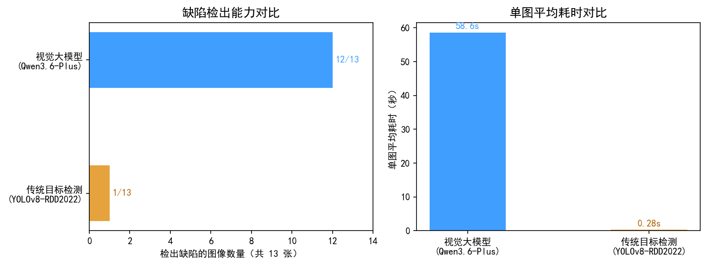

# 道路缺陷智能识别方法对比实验报告

- 实验日期：2026-09-15
- 测试样本：道路实拍图片 13 张（涵盖坑洞、裂缝、龟裂、松散、井盖周边开裂等典型路面病害场景）
- 说明：本报告客观陈述两种技术路线在同一批测试样本上的实际运行结果，供方案选型论证使用。

---

## 一、实验目的

本系统选用视觉大模型作为道路缺陷识别核心。为验证方案选型的合理性，设计本对比实验：在同一样本集上分别运行传统目标检测路线与视觉大模型路线，比较两者的缺陷检出能力、输出信息丰富度与时间开销，为技术路线选择提供实测依据。

## 二、对比方法

### 2.1 传统目标检测路线（YOLOv8-RDD2022）
- 模型：YOLOv8，加载在 RDD2022 道路损伤数据集（国际公开基准，含纵向裂缝、横向裂缝、龟裂、坑洞四类）上微调好的权重；
- 推理环境：本机 CPU，推理阈值采用模型默认置信度阈值（0.25）；
- 输出：目标框 + 类别编号。

### 2.2 视觉大模型路线（Qwen3.6-Plus）
- 模型：通义千问 Qwen3.6-Plus 多模态视觉大模型，通过 DashScope 兼容接口调用；
- 方法：提示词工程约束扫描专业角色与七维输出结构，零样本识别，不依赖任何本系统标注数据；
- 后处理：模型输出经两级 JSON 解析与字段规整，严重程度由规则引擎按《公路技术状况评定标准》(JTG 5210-2018) 分级思路判定（坑洞按直径、裂缝按宽度、车辙按深度、其他按面积占比），模型输出仅作兜底；
- 输出：道路状况、缺陷类型、严重程度、缺陷位置、修复建议、所需材料、紧急程度七维信息，以及缺陷清单（逐缺陷位置、物理尺寸估计、图像归一化检测框）。

## 三、评价指标

1. 检出缺陷的图像数量（张 / 总数）；
2. 缺陷实例数量（视觉大模型以缺陷清单条目计）；
3. 单图平均耗时（秒）；
4. 输出信息维度。

## 四、实验结果

### 4.1 总体对比

| 对比维度 | 视觉大模型 (Qwen3.6-Plus) | 传统目标检测 (YOLOv8-RDD2022) |
| --- | --- | --- |
| 是否需要训练标注 | 否（零样本，提示词工程约束） | 是（需道路缺陷数据微调） |
| 检出缺陷的图像数量 | 12 / 13 | 1 / 13 |
| 缺陷实例数量 | 39 | 1 |
| 单图平均耗时（秒） | 58.6（单张 20.9~168.8） | 0.28 |
| 输出信息 | 七维结构化信息 + 逐缺陷位置/尺寸/检测框 | 仅目标框与类别 |

### 4.2 逐图明细

| 序号 | 样本 | 视觉大模型检出（严重度） | 传统目标检测检出 |
| --- | --- | --- | --- |
| 1 | 15c20d11 | 坑洞（严重） | 无 |
| 2 | 1d124165 | 裂缝（严重），清单含龟裂、裂缝两处、坑洞 | 无 |
| 3 | 2d27998a | 坑洞（严重），另含松散 | 无 |
| 4 | 39889e7d | 坑洞（严重），多坑洞及龟裂 | D40（坑洞） |
| 5 | 40c5e715 | 坑洞（严重），两处 | 无 |
| 6 | 5406df76 | 坑洞（严重），多坑洞及松散 | 无 |
| 7 | 637e799c | 龟裂（中等），另含裂缝 | 无 |
| 8 | 78b262ae | 裂缝（中等），另含松散 | 无 |
| 9 | c17e5d95 | 裂缝（轻微） | 无 |
| 10 | d6aeb324 | 坑洞（严重），多坑洞 | 无 |
| 11 | e3e6e8e6 | 坑洞（严重），多坑洞 | 无 |
| 12 | e659fa36 | 坑洞（中等），多坑洞 | 无 |
| 13 | faa77e96 | 无（路面未见明显缺陷） | 无 |

## 五、结果分析

1. **检出能力**：在本批样本上，视觉大模型检出 12 张图像存在缺陷、累计 39 个缺陷实例；YOLOv8-RDD2022 仅检出 1 张（坑洞）。差异的主要原因：本批测试样本的拍摄视角、场景分布与 RDD2022 训练数据分布差异较大，样本中多为复合病害（如井盖周边开裂、大面积剥落伴多个坑洞），与 RDD 四类粒度的标注口径不完全对齐；视觉大模型为零样本推理，不依赖训练数据分布，对未见场景具有更强的适应性。
2. **输出信息维度**：传统目标检测仅输出目标框与类别，无法给出严重程度、修复建议、所需材料等养护决策所需的深度信息；视觉大模型一次推理即可输出七维结构化信息，并通过规则引擎完成可解释的严重度分级与缺陷定位标注。
3. **时间开销**：视觉大模型单图平均耗时 58.6 秒，为端到端耗时（含云端排队与网络传输）；YOLOv8 本地推理单图 0.28 秒。视觉大模型耗时显著更高，适合对时效要求不苛刻的巡检-复核-处置闭环场景。
4. **说明**：本批样本未提供人工盲评真值，视觉大模型的检出结果未进行人工复核与准确率量化；本报告仅陈述两种模型在相同输入下的实际输出，不作为绝对精度结论。

## 六、结论

在真实道路破损图像上，视觉大模型路线以零样本方式实现了高检出率与高信息密度的识别输出，直接支撑"检测到处置建议"的完整业务闭环；传统目标检测路线虽然推理速度快，但依赖特定数据分布微调，且输出信息不足以支撑养护决策。综合两方面的实测结果，本系统选用视觉大模型作为缺陷识别核心，并预留传统检测模型的接入接口，可根据具体路段的数据基础与时效要求灵活切换。