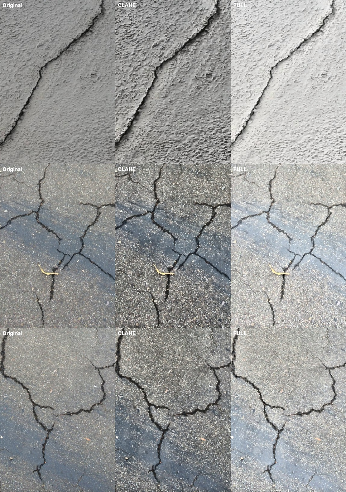
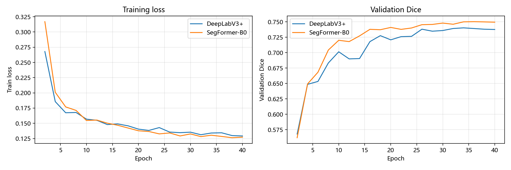
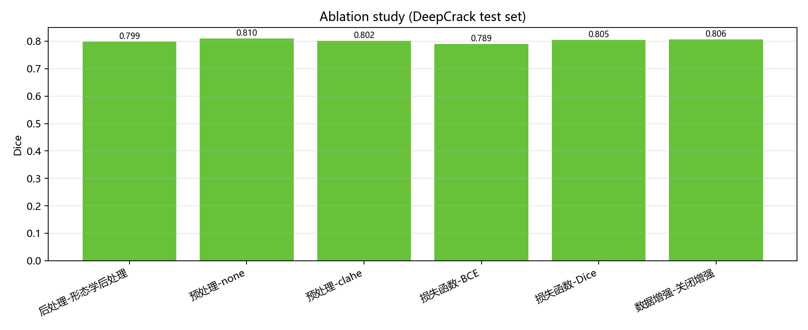
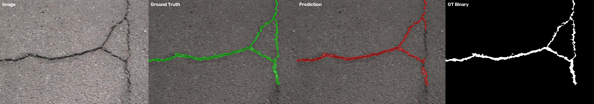
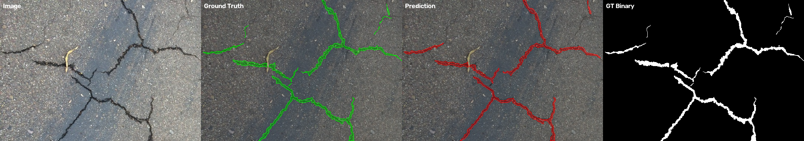

# 面向道路巡检的路面裂缝像素级分割与量化定级系统

## 1. 任务与目标

本课题面向道路巡检场景，任务是**路面裂缝的像素级语义分割**，而不是目标检测。系统输入一张道路图像，输出裂缝的二值掩码，并进一步量化裂缝长度、宽度、面积占比，按 JTG 5210 的分级思路给出严重程度，最终接入现有道路巡检系统的巡检记录与工单流程。

课程要求与完成情况：

| 作业要求 | 完成情况 |
| --- | --- |
| 图像分割任务（非目标检测） | 裂缝二值语义分割 |
| 图像分析、预处理与增强 | 亮度/对比度/阴影/清晰度分析；CLAHE、双边滤波、Retinex、反锐化；预处理消融 |
| 至少两个相关模型，至少一个训练测试 | DeepLabV3+（MobileNetV2）与 SegFormer-B0，两套权重均真实训练与测试 |
| 模型优化与分析 | BCE+Dice、数据增强消融、阈值扫描、形态学后处理、ONNX 轻量化、失败案例分析 |
| Flask 后端前端展示 | 受现有系统技术栈限制，沿用 FastAPI + Vue 3 实现；分割算法服务与业务系统分层 |
| 项目拓展加分 | 裂缝骨架长度、距离变换宽度、面积占比量化，自动分级、自动生成工单 |

## 2. 数据集与图像分析

### 2.1 数据集

| 数据集 | 用途 | 数量 | 标注 |
| --- | --- | --- | --- |
| DeepCrack | 训练、验证、同域测试 | 训练 270、验证 30、测试 237 | 像素级二值掩码 |
| CrackForest（CFD） | 跨数据集泛化测试 | 118 | 像素级二值掩码 |

DeepCrack 官方训练集 300 张，按 9:1 随机切分为 270 张训练、30 张验证；官方测试集 237 张全部作为同域测试。CFD 不参与训练，仅作为跨域测试集，用于观察模型在未见过数据分布上的泛化能力。

DeepCrack 测试集中有 47 张图像是竖版（旋转 90°），训练前统一旋转为横向，避免同一批数据尺寸不一致。

### 2.2 图像特征分析

对四个数据子集统计亮度、对比度、阴影占比、高光占比、清晰度、熵与裂缝像素占比：

| 数据集 | 图像数 | 平均分辨率 | 亮度 | 对比度 | 阴影占比 | 高光占比 | 清晰度 | 熵 | 裂缝像素占比 |
| --- | --- | --- | --- | --- | --- | --- | --- | --- | --- |
| DeepCrack train | 270 | 544x384 | 148.6 | 25.2 | 1.9% | 8.6% | 1372.5 | 6.24 | 2.93% |
| DeepCrack val | 30 | 544x384 | 141.1 | 24.6 | 1.6% | 4.1% | 1186.5 | 6.22 | 2.76% |
| DeepCrack test | 237 | 512x416 | 151.6 | 30.6 | 2.3% | 8.1% | 2113.9 | 6.49 | 4.33% |
| CFD test（跨域） | 118 | 480x320 | 133.1 | 14.2 | 0.0% | 0.2% | 883.7 | 5.77 | 1.62% |

分析结论：

1. 裂缝像素只占图像的 1.6%~4.3%，正负样本极度不平衡，训练损失必须考虑 Dice 等区域重叠指标。
2. CFD 的平均对比度只有 14.2，明显低于 DeepCrack 的 25~30，且亮度更低，说明跨域数据存在光照与成像差异。
3. 高光占比最高约 8%，路面反光会与浅色裂缝混淆；阴影占比 1.6%~2.3%，阴影边缘容易被误判为裂缝。
4. 图像清晰度差异较大，训练集与测试集存在分辨率与模糊程度差异，需要数据增强和标准化预处理。

## 3. 图像预处理与增强

### 3.1 三种预处理模式

| 模式 | 处理步骤 | 目的 |
| --- | --- | --- |
| none | 仅 BGR→RGB | 基线，观察原始图像直接输入的效果 |
| clahe | LAB 空间 CLAHE（clip=2.0，8×8）+ 双边滤波 | 提升局部对比度，抑制噪声 |
| full | clahe + L 通道单尺度 Retinex（σ=30）+ 轻微反锐化 | 抑制阴影与光照不均，增强细裂缝 |

所有模式统一做 ImageNet 均值方差归一化，与预训练骨干保持一致。

### 3.2 预处理对比



从视觉上看，CLAHE 能明显提升裂缝与路面的灰度差异；Retinex 进一步压低阴影和光照不均，但也会放大部分纹理噪声，因此需要实验验证而不是默认“越强越好”。

### 3.3 预处理消融

为验证预处理是否真的有效，固定 DeepLabV3+（MobileNetV2）、BCE+Dice 损失、数据增强与 40 轮训练，只改变预处理模式：

| 预处理模式 | 最佳轮次 | 验证 Dice | 验证 IoU | 测试 Dice | 测试 IoU | 测试边界 IoU |
| --- | --- | --- | --- | --- | --- | --- |
| none（仅 RGB） | 38 | **0.7620** | **0.6350** | **0.8100** | **0.6983** | **0.5611** |
| clahe（CLAHE + 双边滤波） | 38 | 0.7372 | 0.6043 | 0.8018 | 0.6822 | 0.5265 |
| full（CLAHE + Retinex + 反锐化） | 34 | 0.7402 | 0.6081 | 0.7990 | 0.6785 | 0.5408 |

结论：

1. **在本实验条件下，none 反而最好**：验证集和测试集 Dice 都高于 clahe 与 full，测试 Dice 比 full 高 1.1 个百分点，边界 IoU 高 2.0 个百分点。
2. **CLAHE 不是越强越好**：单独使用 CLAHE 时，局部对比度提升的同时放大了路面纹理与噪点，验证 Dice 比 none 低 2.5 个百分点。
3. **Retinex + 反锐化会损失弱裂缝信息**：full 模式进一步压低阴影，但也会把细裂缝与背景一起平滑，测试 Dice 略低于 clahe。
4. 这与 5.5 的传统 Otsu 结果并不矛盾：Otsu 依赖全局灰度分布，full 预处理能提升其 Dice（0.5019 → 0.5355）；而 ImageNet 预训练网络本身已有一定光照鲁棒性，过强预处理反而会破坏输入分布。

因此，预处理的价值取决于后续算法。系统保留 none / clahe / full 三种模式供前端对比，主模型默认 full 只是工程折中；如果只追求 DeepCrack 同域指标，none 是更优选择。

## 4. 分割模型与训练

### 4.1 模型

| 模型 | 骨干 | 参数量 | 特点 |
| --- | --- | --- | --- |
| DeepLabV3+ | MobileNetV2（ImageNet 预训练） | 4.38M | 空洞卷积 + 轻量骨干，速度快，适合巡检端侧部署 |
| SegFormer-B0 | MiT-B0（ImageNet 预训练） | 3.71M | Transformer 编码器 + 轻量 MLP 解码器，全局感受野更强 |

两个模型都不属于课程中常见的分类网络（ResNet/VGG 等），满足“不能全是课上用过的模型”的要求；两个模型都完成了真实训练与测试。

### 4.2 训练配置

| 配置项 | 取值 |
| --- | --- |
| 输入尺寸 | 训练随机裁剪 384×384；验证/测试填充到 384×544（32 的倍数） |
| 批大小 | 8 |
| 轮数 | 40 |
| 优化器 | AdamW，编码器学习率 1e-4，解码器 1e-3 |
| 学习率调度 | CosineAnnealingLR，最小 1e-6 |
| 损失函数 | 0.5×BCEWithLogits + 0.5×Soft Dice |
| 混合精度 | FP16 AMP |
| 梯度裁剪 | 5.0 |
| 早停 | 验证集 Dice 连续 8 轮不提升 |
| 数据增强 | 随机裁剪、水平/垂直翻转、±15° 旋转、亮度/对比度扰动、高斯模糊、高斯噪声 |

### 4.3 训练曲线



DeepLabV3+ 最佳验证 Dice 为 0.740（第 34 轮），SegFormer-B0 最佳验证 Dice 为 0.750（第 36 轮）。两条曲线在 20 轮后趋于平稳，未出现明显过拟合。

## 5. 实验结果与分析

### 5.1 主模型对比

在 DeepCrack 同域测试集与 CFD 跨域测试集上，阈值 0.5、启用形态学后处理：

| 模型 | DeepCrack IoU | DeepCrack Dice | Precision | Recall | 边界 IoU | CFD IoU | CFD Dice | CFD Precision | CFD Recall | 参数量 | GPU 单图 | ONNX CPU 单图 |
| --- | --- | --- | --- | --- | --- | --- | --- | --- | --- | --- | --- | --- |
| DeepLabV3+ (MobileNetV2) | 0.6785 | 0.7990 | 0.8776 | 0.7594 | 0.5408 | 0.3786 | 0.5320 | 0.6716 | 0.4794 | 4.38M | 7.0ms | 23.12ms |
| SegFormer-B0 | **0.6935** | **0.8118** | 0.8683 | **0.7836** | **0.5424** | **0.4249** | **0.5856** | 0.6292 | **0.5795** | 3.71M | 21.7ms | 61.79ms |

结论：

1. **SegFormer-B0 精度更高**：同域 Dice 提升 1.3 个百分点，跨域 Dice 提升 5.4 个百分点，说明 Transformer 的全局建模对跨域泛化更有利。
2. **DeepLabV3+ 速度更快**：GPU 单图 7.0ms，约为 SegFormer 的 1/3；ONNX CPU 单图 23ms，可满足无人机机载或边缘设备的实时巡检需求。
3. **跨域性能明显下降**：两个模型在 CFD 上的 Dice 都低于同域 20 个百分点以上，说明数据分布差异（对比度、路面材质、拍摄视角）仍是主要挑战。
4. 参数量上 SegFormer 更小，但推理更慢，原因是 Transformer 的注意力计算与解码器结构；模型选型不能只看参数量。

### 5.2 阈值扫描

DeepLabV3+ 在 DeepCrack 测试集上的阈值扫描：

| 阈值 | Dice | IoU | Precision | Recall |
| --- | --- | --- | --- | --- |
| 0.3 | **0.8087** | **0.6909** | 0.8490 | 0.7999 |
| 0.4 | 0.8044 | 0.6852 | 0.8629 | 0.7801 |
| 0.5 | 0.7987 | 0.6779 | 0.8754 | 0.7604 |
| 0.6 | 0.7916 | 0.6686 | 0.8874 | 0.7398 |
| 0.7 | 0.7818 | 0.6558 | 0.8997 | 0.7154 |

阈值降低会提高召回率但降低精确率；0.3~0.4 区间 Dice 最优。系统默认使用 0.5，偏保守，实际部署可根据“漏检代价 vs 误检代价”调整。

### 5.3 后处理

| 模型 | 原始 Dice | 后处理 Dice | 原始 IoU | 后处理 IoU | 说明 |
| --- | --- | --- | --- | --- | --- |
| DeepLabV3+ | 0.7987 | 0.7990 | 0.6779 | 0.6785 | 去小连通域 + 闭运算，指标基本持平 |
| SegFormer-B0 | 0.8114 | 0.8118 | 0.6928 | 0.6935 | 指标略升，主要收益在噪点清理与断线连接 |

后处理的主要作用不是提升像素指标，而是去除孤立噪点、连接断裂裂缝，让掩码更适合量化和可视化。

### 5.4 消融实验

统一在 DeepCrack 测试集上评估，阈值 0.5；除“关闭后处理”一行外均启用形态学后处理。每次只改变一个因素，其余与主模型一致：

| 实验组 | 配置 | 验证 Dice | 测试 Dice | 测试 IoU | 测试边界 IoU | 说明 |
| --- | --- | --- | --- | --- | --- | --- |
| 主模型 | full + BCE+Dice + 增强 | 0.7402 | 0.7990 | 0.6785 | 0.5408 | 基准 |
| 预处理 | none | **0.7620** | **0.8100** | **0.6983** | **0.5611** | 同域指标最优 |
| 预处理 | clahe | 0.7372 | 0.8018 | 0.6822 | 0.5265 | 纹理噪声增加 |
| 损失函数 | 仅 BCE | 0.6614 | 0.7894 | 0.6656 | 0.5163 | 正负样本不平衡，明显最差 |
| 损失函数 | 仅 Dice | 0.7395 | 0.8048 | 0.6841 | 0.5320 | 召回更高，精确率略低 |
| 数据增强 | 关闭增强 | 0.7538 | 0.8062 | 0.6868 | 0.5393 | 同域略优 |
| 后处理 | 关闭后处理（仅阈值） | - | 0.7987 | 0.6779 | 0.5419 | 噪点多，量化稳定性略差 |



分析：

1. **损失函数影响最大**：仅 BCE 的测试 Dice 比主模型低 1.0 个百分点，说明裂缝像素只占图像的 2%~4% 时，纯像素级交叉熵容易被背景主导；Dice 类损失对区域重叠更敏感。
2. **仅 Dice 略优于 BCE+Dice**：测试 Dice 0.8048 对 0.7990，但精确率从 0.8776 降到 0.8441，召回率从 0.7594 升到 0.7944。两者差距在 0.6 个百分点内，系统仍保留 BCE+Dice 以兼顾精确率与训练稳定性。
3. **关闭增强在同域测试上高 0.7 个百分点**：DeepCrack 训练集与测试集分布接近，而 ±15° 旋转、高斯噪声等强增强会改变细裂缝形态。该结果只能说明同域指标不是增强的唯一目标；跨域与现场鲁棒性还需要额外的跨域消融验证。
4. **预处理的影响见 3.3**：none 最优，full 与 clahe 相近，说明预训练模型对光照已有一定鲁棒性。
5. **后处理对像素指标影响很小**（Dice 提升 0.03 个百分点），它的主要价值是去除孤立噪点、连接断线，让骨架长度与宽度量化更稳定。

总体来看，几个较优配置的测试 Dice 都在 0.799~0.810 之间，差距不超过 1.1 个百分点。主模型选择 full + BCE+Dice + 增强，是为了覆盖现场光照变化与拍摄角度差异；如果只针对 DeepCrack 同域数据，none + Dice 的组合指标更高。最终配置应由实际巡检数据决定，而不是只看单一测试集。

### 5.5 与传统图像处理对比

Otsu 反阈值 + 形态学后处理：

| 预处理 | DeepCrack Dice | DeepCrack IoU | CFD Dice | CFD IoU |
| --- | --- | --- | --- | --- |
| none | 0.5019 | 0.4243 | 0.0761 | 0.0408 |
| clahe | 0.2747 | 0.1978 | 0.0724 | 0.0387 |
| full | 0.5355 | 0.4201 | 0.1207 | 0.0692 |

传统方法在 DeepCrack 上最高 Dice 只有 0.5355，远低于深度学习模型的 0.80；在 CFD 上几乎失效（Dice 0.12）。说明裂缝的形态、宽度、光照变化太大，固定阈值无法泛化，必须使用可学习模型。CLAHE 单独使用时反而破坏了 Otsu 的全局阈值假设，因此预处理方法必须与后续算法匹配。

### 5.6 失败案例分析





典型失败情形：

1. **极细裂缝**：宽度只有 1~2 像素时，下采样与阈值化容易丢失，表现为召回率下降。
2. **阴影与浅色反光**：阴影边缘、路面高光与裂缝的灰度接近，产生误检。
3. **水渍与路面纹理**：龟裂状纹理可能被误判为裂缝，尤其跨域数据中更明显。
4. **标注边界模糊**：人工掩码对裂缝边缘的判定存在主观差异，边界 IoU 普遍低于区域 IoU。

## 6. 裂缝量化与分级

### 6.1 量化方法

1. 对二值掩码做连通域分析，剔除面积小于 30 像素的噪点。
2. 对每个连通域做骨架化（skeletonize），骨架像素数作为裂缝长度。
3. 对每个连通域做距离变换，骨架处的 2×距离值作为裂缝宽度，取 95 分位数作为最大宽度，避免单点噪声。
4. 统计裂缝总面积与图像面积占比；通过标定比例 `mm_per_pixel` 换算为毫米。

### 6.2 严重程度分级

复用现有 `backend/services/dingji.py` 的 JTG 5210 分级思路：

| 裂缝最大宽度 | 等级 |
| --- | --- |
| < 3mm | 轻微 |
| 3~10mm | 中等 |
| ≥ 10mm | 严重 |

宽度不可用时，退化为按裂缝面积占比分级（5%、15% 两档）。

### 6.3 实例

测试图 `11129.jpg`（DeepCrack 测试集）的量化结果：

| 指标 | 数值 |
| --- | --- |
| 裂缝处数 | 5 |
| 累计长度 | 818.0mm |
| 最大宽度 | 10.2mm |
| 严重程度 | 严重 |
| 紧急程度 | 立即封路 |

系统据此自动生成处置工单，并写入巡检记录。

## 7. 系统实现

### 7.1 整体结构

```
Vue 3 前端
   ├── 巡检记录 / 工单 / 仪表盘（原有业务）
   └── 裂缝分割页（新增）
          │  /api/segmentation/*
FastAPI 后端
   ├── routers/segmentation.py     分割接口
   ├── services/segmentation_service.py  推理、量化、分级、落库
   └── 原有巡检 / 工单 / 道路 / 用户接口
          │
segmentation/ 算法模块
   ├── 训练、评估、消融脚本
   ├── 预处理、后处理、量化模块
   └── weights/ 两套训练权重
```

### 7.2 后端接口

| 方法 | 路径 | 说明 |
| --- | --- | --- |
| GET | `/api/segmentation/models` | 模型列表、权重状态、验证集指标 |
| GET | `/api/segmentation/experiments` | 训练/消融实验汇总 |
| POST | `/api/segmentation/preprocess-demo` | 返回 none/clahe/full 三种预处理结果 |
| POST | `/api/segmentation/analyze` | 单模型分割；可保存巡检记录 |
| POST | `/api/segmentation/compare` | 双模型对比 |

`/analyze` 在 `save_inspection=true` 时：

1. 写入 `inspections` 表，`ai_result` 中保存分割结果、量化指标与分级依据；
2. 当分级为中等或严重时，自动创建 `workorders` 工单；
3. 前端可查看叠加图、掩码、量化指标与工单。

### 7.3 前端页面

新增 `裂缝分割` 页面，包含：

- 图片上传、模型选择（DeepLab / SegFormer / 双模型对比）
- 毫米/像素标定比例、预处理模式选择
- 缺陷叠加图与分割掩码
- 裂缝处数、累计长度、最大宽度、面积占比四项指标
- 严重程度、紧急程度、分级依据、修复建议
- 预处理三栏对比（原图 / CLAHE / Retinex）及亮度、对比度、阴影占比
- 模型对比与消融实验图表

巡检详情页在检测到 `ai_result.seg` 时，额外展示分割掩码、叠加图与量化指标。

## 8. 结论与不足

### 结论

1. 两个真实训练的分割模型均达到可用水平：DeepCrack 测试 Dice 0.799~0.812，明显优于传统 Otsu 的 0.536。
2. SegFormer-B0 精度与跨域泛化更好；DeepLabV3+ 速度约为 SegFormer 的 3 倍，更适合实时巡检。
3. 预处理、损失函数、数据增强、后处理与阈值都会影响最终效果，需通过实验选择而不是拍脑袋。
4. 分割掩码可以直接支撑裂缝长度、宽度、面积量化，并与现有巡检/工单流程闭环。

### 不足

1. 跨域性能下降明显，CFD 上 Dice 仅 0.53~0.59，后续可加入域适应、伪标签或更多航拍数据。
2. 目前是二分类裂缝分割，未区分纵向裂缝、横向裂缝、龟裂、坑洞等细类；多类别分割需要更细的像素级标注。
3. `mm_per_pixel` 需要现场标定，当前默认 1 像素=1 毫米，仅用于演示；无人机实际部署需结合飞行高度、相机参数与地面分辨率换算。
4. 受现有系统技术栈限制，课程要求的 Flask 未单独引入，前端展示沿用 FastAPI + Vue；这一点在答辩时需要说明。

## 9. 复现说明

1. 安装依赖：`pip install -r segmentation/requirements.txt`（或使用已有的 `yolo` conda 环境）。
2. 准备数据：`python segmentation/prepare_data.py`。
3. 训练主模型：
   ```
   python train.py --model deeplabv3plus_mobilenetv2 --preprocess full --loss bce_dice --epochs 40 --weights-name deeplabv3plus_mobilenetv2_best.pth
   python train.py --model segformer_b0 --preprocess full --loss bce_dice --epochs 40 --weights-name segformer_b0_best.pth
   ```
4. 评估：`python evaluate.py --checkpoint weights/xxx_best.pth --data data/processed/deepcrack/test`。
5. 汇总与绘图：`python summarize_experiments.py && python plot_results.py`。
6. 启动后端：`cd backend && python -m uvicorn main:yingyong --host 0.0.0.0 --port 8001`。
7. 启动前端：`cd frontend && npm run dev`，使用 `admin / admin123` 登录，进入“裂缝分割”页面。

## 10. 答辩演示流程与预设问题

### 10.1 演示流程

1. 打开“裂缝分割”页面，选择 DeepLabV3+，上传一张裂缝图片。
2. 点击“预处理对比”，展示原图、CLAHE、Retinex 三栏及亮度/对比度/阴影指标。
3. 点击“开始分割”，展示叠加图、掩码、裂缝处数、长度、最大宽度、面积占比、严重程度与修复建议。
4. 保存为巡检记录，展示自动生成的工单。
5. 切换到“双模型对比”，展示 DeepLabV3+ 与 SegFormer-B0 的结果差异与耗时差异。
6. 滚动到“模型对比与消融实验”，展示 IoU/Dice 柱状图与消融表格。

### 10.2 预设问题

| 问题 | 回答要点 |
| --- | --- |
| 为什么不做目标检测？ | 作业明确排除目标检测；裂缝是细长结构，像素级掩码能直接支撑长度、宽度量化，边界框无法做到。 |
| 为什么选这两个模型？ | DeepLabV3+ 轻量、速度快，适合巡检端侧；SegFormer-B0 全局感受野强、跨域泛化好。两个都不是课堂常见的分类网络，且都完成了真实训练与测试。 |
| 预处理真的有用吗？ | 不是“越强越好”。实验显示传统 Otsu 在 full 预处理下提升明显，但深度模型在 full 下验证 Dice 反而略低于 none，说明预训练模型已有一定光照鲁棒性，过强增强会引入噪声。报告如实呈现这一结论。 |
| 毫米宽度怎么来的？ | 距离变换得到像素宽度，乘以现场标定的 `mm_per_pixel`。当前演示默认 1 像素=1 毫米，实际无人机部署需按飞行高度、相机焦距和地面分辨率换算。 |
| 跨域为什么掉这么多？ | CFD 与 DeepCrack 的对比度、路面材质、拍摄视角差异大；后续可做域适应、伪标签或加入航拍数据微调。 |
| 为什么后端不是 Flask？ | 现有巡检系统是 FastAPI + Vue，为了不改动比赛系统，分割算法作为独立服务接入同一后端；FastAPI 与 Flask 同为 Python Web 框架，接口与前端展示能力一致。 |

